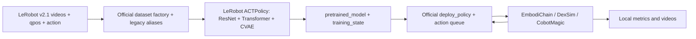

# Architecture and upstream API audit

核查日期：2026-10-17。本仓库提供配置、数据契约检查和启动器，不重新实现 ACT Transformer/CVAE，不复制上游模型或仿真代码。

ACT 用视觉和机器人状态预测一段动作。训练的 VAE encoder 使用状态和目标 action chunk 构建潜变量，优化 action L1 reconstruction 与 KL 项；推理时不输入未来真实动作。固定 LeRobot 默认 `kl_weight=10`，即 `loss = l1_loss + 10 * kld_loss`。这说明代码目标函数，不代表已取得历史训练 loss。

主要接口与证据：

| 源码 | 已核查行为 |
| --- | --- |
| [RoboSyn train.py](https://github.com/EDEM-AI/RoboSynChallenge/blob/64b0775eddb3ed8c4c3d1212f322e8a9d036e9d6/policy/act/scripts/train.py) | 构建 DatasetConfig、ACTConfig、TrainPipelineConfig；补 metadata/stats/item/padding 的旧字段 aliases，调用 lerobot.scripts.train |
| [LeRobot ACTPolicy](https://github.com/huggingface/lerobot/blob/b883328e6c95681ca90a18b102e4ae5e1f91e2bf/src/lerobot/policies/act/modeling_act.py) | forward 返回 loss 与 l1_loss/kld_loss；select_action 在队列为空时预测 chunk，执行前 n_action_steps 个动作 |
| [ACTConfig](https://github.com/huggingface/lerobot/blob/b883328e6c95681ca90a18b102e4ae5e1f91e2bf/src/lerobot/policies/act/configuration_act.py) | n_obs_steps=1；n_action_steps ≤ chunk_size；temporal ensemble 要求 n_action_steps=1 |
| [Official eval.sh](https://github.com/EDEM-AI/RoboSynChallenge/blob/64b0775eddb3ed8c4c3d1212f322e8a9d036e9d6/policy/act/eval.sh) | 接受 PYTHON_BIN；切换官方仓库 cwd；加载 deploy_policy.yml 并转交 overrides |
| [deploy_policy.py](https://github.com/EDEM-AI/RoboSynChallenge/blob/64b0775eddb3ed8c4c3d1212f322e8a9d036e9d6/policy/act/deploy_policy.py) | ACTPolicy.from_pretrained；robot/qpos 与三相机输入；检查动作维度；逐步 env.step；reset_model 清空队列 |
| [EmbodiChain setup](https://github.com/DexForce/EmbodiChain/blob/89c14da8d/setup.py) | task 包实际位于 embodichain_tasks/embodichain_tasks；显式 task PYTHONPATH 支持历史源码布局 |

`act_step` 是每次部署适配器调用里循环多少个 env.step，**不是** ACT 的 `n_action_steps`。模型调用数由 action queue 是否为空或 temporal ensemble 决定。

本地 `dataset_adapter.py` 是可独立测试的 alias/shape 契约工具；生产训练继续使用官方包装器的 adapter，包括 metadata 与归一化统计。它不会改写磁盘数据。当前核查 revision 不保证等于 10 月 4 日训练环境中的 revision；历史源码 SHA 待补。

## License audit

本仓库原创代码保留 [MIT](../LICENSE)。RoboSynChallenge 的 [LICENSE](https://github.com/EDEM-AI/RoboSynChallenge/blob/64b0775eddb3ed8c4c3d1212f322e8a9d036e9d6/LICENSE)、LeRobot 的 [LICENSE](https://github.com/huggingface/lerobot/blob/b883328e6c95681ca90a18b102e4ae5e1f91e2bf/LICENSE) 与 EmbodiChain 的 [LICENSE](https://github.com/DexForce/EmbodiChain/blob/89c14da8d/LICENSE) 均含 Apache-2.0 条款；LeRobot 还保留其第三方派生代码声明。这里通过导入/子进程复用，不将其重新许可为 MIT。DexSim 私有 wheel、数据、权重及仿真资产需要分别遵守供应方条款；开源代码许可不等于资产可自由再分发。
